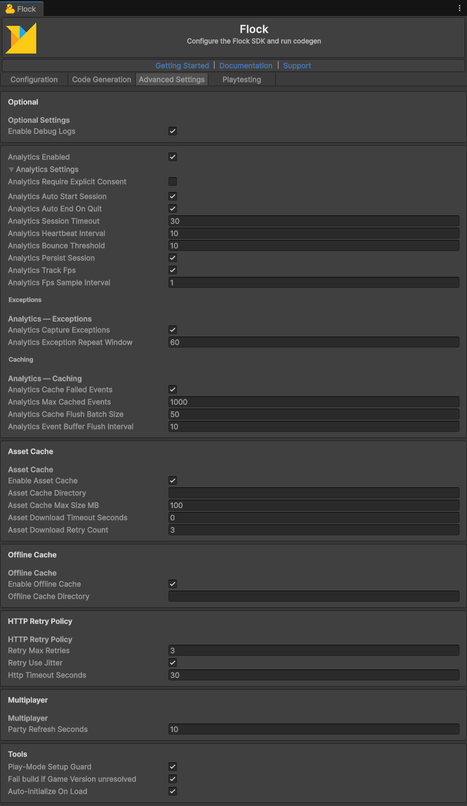

# Analytics

[← Back to README](../README.md)

A game reports two different things, and they land on two different dashboards:

| | Gameplay analytics | Diagnostics |
|---|---|---|
| Answers | What players did | What went wrong |
| Read on | Dashboards → Game Metrics | Diagnostics → Events and Errors |
| Calls | `TrackEvent`, `RecordScreenView`, sessions, `RecordTransactionAsync` | `LogDiagnosticEvent`, `LogDiagnosticError`, `LogDiagnosticException` |
| Custom data | Properties keep their JSON type, so a number can be charted | Extra data and error data, stored with the entry |
| Nobody signed in | Held, and credited to whoever signs in next | Sent as usual |

`TrackEvent` and the `LogDiagnostic...` calls never throw and never wait on the network: each writes one small file to a queue
on disk, on the calling thread, and returns; entries are sent on the flush triggers (every **Analytics Event Buffer Flush
Interval** seconds, default 10, and on pause, session end and sign-in). `StartSessionAsync`
and `RecordTransactionAsync` send at once and need a signed-in player: before sign-in the session runs locally (an error is
logged) and a transaction fails.

Every analytics setting is in **Flock > Settings**, **Advanced Settings** tab, **Analytics** card: **Analytics Enabled**, and
under the **Analytics Settings** foldout the session, **Exceptions** and **Caching** settings. A game that starts the SDK
itself sets the same values on `FlockInitConfig.AnalyticsConfig` (a `FlockAnalyticsConfig`).


*Flock > Settings, Advanced Settings tab: the Analytics card with Analytics Enabled ticked and the Analytics Settings foldout open, showing its Exceptions and Caching groups.*

## Gameplay events

```csharp
using System.Collections.Generic;
using Flock;

public static class ProgressEvents
{
    // False when the event was refused (a warning in the console says why).
    public static bool LevelComplete(int level, double seconds, int stars)
    {
        Dictionary<string, object> properties = new Dictionary<string, object>
        {
            { "level", level }, { "time", seconds }, { "stars", stars }
        };
        return FlockClient.Instance.Analytics.TrackEvent("level_complete", properties, eventCategory: "progress");
    }
}
```

- Safe offline and from any thread. Each call writes one file, so record what happened (a level completed), not every
  frame. Properties keep their keys and JSON types, 64-bit numbers included.
- Recorded while nobody is signed in, an event is held and credited to whoever signs in next; the server refuses an event
  without a player it knows.
- Refused with `false` and a warning: an empty name, a name over `FlockAnalyticsProvider.MaxEventNameLength` (200)
  characters or a category over `MaxEventCategoryLength` (100) (the server cannot store either, and would fail every event
  sent with it), `session_started` (the server records it itself when a session starts), or properties that cannot be
  written as JSON. Without consent it is refused quietly.
- With **Analytics Cache Failed Events** off (`CacheFailedEvents` in code) there is no queue: the event is sent once, straight away, while a player is signed in, and
  dropped otherwise.
- The SDK records no gameplay events of its own, so the Game Metrics dashboards show only what your game tracks.

## Diagnostics

```csharp
using System;
using Flock;
using UnityEngine;

public static class Diagnostics
{
    public static void LoadSave(string json)
    {
        try
        {
            JsonUtility.FromJson<SaveData>(json);
        }
        catch (Exception exception)
        {
            // An exception you caught yourself: report it, since the SDK hears only the ones nobody caught.
            FlockClient.Instance.Analytics.LogDiagnosticException(exception);
        }
    }

    public static void ReportDesync()
    {
        FlockClient.Instance.Analytics.LogDiagnosticError("inventory desync", errorCode: "INV_001");
    }

    public static void ReportCheckpoint()
    {
        FlockClient.Instance.Analytics.LogDiagnosticEvent("checkpoint reached");
    }

    [Serializable]
    public class SaveData
    {
        public int level;
    }
}
```

The game's exceptions are captured for you (below). `LogEvent`, `LogError` and `LogException`, the former names, still work
and forward to these; they are marked obsolete, so the compiler names the replacement.

## Exceptions

From the moment the SDK is created, before anyone signs in too, it reports the game's exceptions under Diagnostics →
Errors, with nothing to call:

- an exception thrown on the main thread (`Update`, coroutines, event handlers) or passed to `Debug.LogException` on any
  thread;
- an exception no thread caught, and one thrown from an `async void` method;
- a faulted task nobody awaited, reported when the garbage collector finalizes it, so it can arrive late.

`Debug.LogError` lines are not exceptions and are not reported; call `LogDiagnosticError` for an error you want on the
dashboard. The SDK's own exceptions are not the game's and are not reported either. Each entry's extra data names where it
came from in `exception_source`: `log`, `unobserved_task` or `unhandled`.

**Repeats are counted, not sent one by one.** The first occurrence of a fault is sent at once. Its repeats within
**Analytics Exception Repeat Window** (60 s by default) are counted, and when the window closes one more entry is sent with
`repeat_count` (how many more times it happened) and `repeat_window_seconds`. An exception thrown every frame therefore
costs about two entries a minute, not one per frame. A window of 0 (or less, set from code) sends every occurrence. Two occurrences are the same
fault when their message matches, numbers and `0x` addresses in it aside, and so do the first two stack frames below
Unity's own logging. Summaries still open when the game quits are queued then, and sent like any other entry.

**A launch reports at most 100 different faults.** Past that, a new fault is only counted, and an
`exception_reports_held_back` entry (Diagnostics → Events) says how many reports were held back, at most once a minute. Faults
already reported keep sending their summaries. A burst of more than 256 exceptions between two frames is counted the same
way.

| Setting (Flock > Settings, Advanced Settings tab, Analytics card, Exceptions) | Code (`FlockAnalyticsConfig`) | Default |
|---|---|---|
| Analytics Capture Exceptions | `FlockAnalyticsConfig.CaptureExceptions` | on |
| Analytics Exception Repeat Window | `FlockAnalyticsConfig.ExceptionRepeatWindowSeconds` | 60 s |

- With capture off, `LogDiagnosticException` still records; nothing is captured on its own.
- Consent-gated like all diagnostics: an exception seen without consent is dropped, and its fault is reported in full
  the first time it happens with consent.
- With Unity's logging switched off (`Debug.unityLogger.logEnabled = false`), Unity hands over no exceptions, so only an
  exception no thread caught and a faulted task nobody awaited are reported.
- A player built with **Stack Trace** set to None for exceptions hands the SDK no stack, so it sends the frames that
  logged the exception instead, from the game's call to `Debug.LogException`. An exception Unity caught itself (thrown
  from `Update`, say) then has no frame of the game's, and the same-fault rule goes by its message alone.
- A captured exception's message is cut to 4,096 characters and its stack to 8,192, and the entry notes the full length at
  the cut (`[cut from 70000 characters]`). What you report yourself through `LogDiagnosticException` is not cut.
- An exception whose own `Message` getter throws (an override that reads a null field, say) is reported under its type
  name, with `(its message could not be read: ...)` in place of its message; one whose `StackTrace` getter throws is sent
  with no stack.

## Sessions, transactions and screen views

```csharp
using System.Threading.Tasks;
using Flock;
using Flock.Analytics;
using Flock.Models;
using UnityEngine;

public static class SessionsAndTransactions
{
    // Sessions start at sign-in when Analytics Auto Start Session is on (the default). Otherwise:
    public static async Task PlayOneSessionAsync()
    {
        await FlockClient.Instance.Analytics.StartSessionAsync();
        await FlockClient.Instance.Analytics.EndSessionAsync();
    }

    // Optional: send everything queued now (waits for a send already under way, then sends what is left).
    // The result counts what this call sent and what the server refused for good (those entries are dropped);
    // entries a passing failure left queued are in neither count.
    public static async Task SendQueuedNowAsync()
    {
        FlockFlushResult flushed = await FlockClient.Instance.Analytics.FlushAsync();
        if (!flushed.NothingLost)
            Debug.LogWarning($"{flushed.Refused} analytics entries were refused: {flushed.FirstRefusal}");
    }

    // What the exception capture hears right now (nothing with analytics or capture off): a tool that
    // provokes an exception to see it reported reads this first.
    public static bool CaptureHearsEverything()
    {
        FlockExceptionCaptureCoverage capture = FlockClient.Instance.Analytics.GetExceptionCaptureCoverage();
        return capture.IsComplete;
    }

    // Sent at once; needs a signed-in player. TransactionType and Status default to "purchase" and "completed".
    public static Task RecordPurchaseAsync()
    {
        return FlockClient.Instance.Analytics.RecordTransactionAsync(new AnalyticsTransactionRequest
        {
            Amount = 4.99, CurrencyCode = "USD", TransactionType = "purchase", Status = "completed"
        });
    }

    // Screen views stay on the device and are counted into the session's ScreensViewed.
    public static void ShowMainMenu()
    {
        FlockClient.Instance.Analytics.RecordScreenView("MainMenu");
    }
}
```

**Session ids.** `FlockClient.Instance.CurrentSessionId` has an id from the moment a session starts: the server's once the
server has the session, the SDK's own local id until then (the one `FlockEvents.OnSessionStarted` hands over).
`FlockClient.Instance.ServerSessionId` is only ever the server's: null until the session's start has reached the server
(offline, for one), and null again once the session has ended. Read `ServerSessionId` when another service must name the
session, and read it again later while it is null; there is no event for its arrival.

## Consent

By default, analytics behaves as it always has — collection runs once a player is authenticated. Turn on **Analytics Require Explicit Consent** (Flock > Settings, **Advanced Settings** tab, **Analytics Settings** foldout; `FlockAnalyticsConfig.RequireExplicitConsent` in code) for a real opt-in gate: no session, no event tracking, no device/FPS/screen-view capture until the game calls `SetConsent(true)`.

```csharp
using Flock;

public static class ConsentScreen
{
    // Granting starts the session again when a player is signed in.
    public static void Accept()
    {
        FlockClient.Instance.Analytics.SetConsent(true);
    }

    // Revoking discards the running session (it is never sent) and stops all sending.
    // Entries already queued on the device stay there, unsent, until consent comes back or they are erased.
    public static void Decline()
    {
        FlockClient.Instance.Analytics.SetConsent(false);
    }

    // Also deletes everything queued on the device and not yet sent.
    public static void DeclineAndErase()
    {
        FlockClient.Instance.Analytics.SetConsent(false);
        FlockClient.Instance.Analytics.EraseLocalAnalyticsData();
    }

    public static bool HasConsent => FlockClient.Instance.Analytics.HasConsent;
}
```

`FlockEvents.OnConsentChanged` is raised when the stored answer changes; see [SDK Events](events.md).

- Revoking discards the running session, so `OnSessionEnded` does not fire for it.
- The decision persists across launches — no need to call `SetConsent` again unless it changes.
- `TrackEvent` and the `LogDiagnostic...` calls are gated the same as sessions — they carry player-identifiable data too.
- `RecordTransactionAsync` is the one exception — **not** gated by consent, since purchase records typically need to be retained for financial/tax reasons independent of tracking consent.
- `EraseLocalAnalyticsData()` is local-only: it clears events, session-end records, and log/crash events queued on-device but not yet sent. It does not delete analytics already delivered to Flock's backend — there's no backend endpoint for that today.

## Unexpected-termination detection

If a run died without a clean quit (crash, hang force-kill, foreground OOM, power loss), the SDK detects it on a later launch and queues one `app_termination` diagnostic (type debug, under Diagnostics → Events) automatically — nothing to call. It is a record about a crash, so it stays off the Game Metrics dashboards.

Each launch keeps its crash marker, its live-session record and its event queues in a folder of its own under `Application.persistentDataPath/Flock/analytics/games/<game>/launches/`, locked while it runs. Each game's are kept apart (by its backend and API key), so a project that switches to another game never sends the old game's unsent analytics to the new one; what an earlier version kept for every game is taken over by the first game to start after the update. The consent answer stays the same for every game on the device. A launch takes over only the folders of launches that have ended, so two copies of a game running at once (or the Editor beside a player) never report each other as crashed, end each other's session or send each other's queued events. What an ended launch left is reported once, by whichever launch takes it over.

| Extra data | Meaning |
|---|---|
| `previous_session_id` | The session that was running; left out when none was (a crash before sign-in, or after a session ended) |
| `classification` | `background_kill` (died while backgrounded — OS eviction / swipe-close) or `abnormal` (died foregrounded without the quit path) |
| `last_alive_at` | Approximate death time (last persisted heartbeat) |
| `unhandled_exception_count` | Exceptions captured during that run, repeats included (none with capture off) — context only, not proof of a crash |
| `app_version` / `sdk_version` | Versions of the run that died |

The marker is kept from start-up to a clean quit, not only while a session runs, so a crash before sign-in or after
sign-out is reported too.

- Quitting via Alt-F4 / the window close button is a **clean** exit (Unity runs its quit path) — no event.
- Swipe-closing on mobile reports `background_kill`, because the app switcher backgrounds the app first.
- Requires **Analytics Persist Session** (`PersistSessionOnDisk` in code); the Editor and WebGL never record a marker of their own (no reliable lifecycle there). The Editor does report a standalone player's crash, since they share the folder.
- On macOS and Linux the lock may hold only within one process (unverified there), so two copies running at the same moment may not be told apart. A copy that has ended is taken over as usual.
- Consent-gated like all analytics; a dirty exit found while consent is off is discarded.

See also: [SDK Events](events.md) for the session lifecycle events (`OnSessionStarted`, `OnSessionEnded`, `OnSessionPaused`, `OnSessionResumed`).
