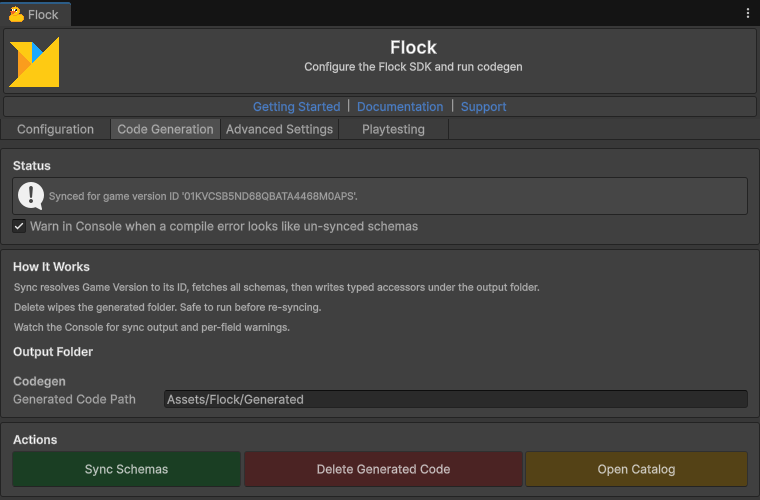

# Codegen

[← Back to README](../README.md)

Codegen turns what you set up in the Flock dashboard (player templates, game configs, shops, achievements) into typed C#,
so your game reads `progress.Level` instead of looking a field up by its name, and a misspelt name fails when the game
compiles instead of when a player plays.

## Running Sync Schemas

1. Fill in the **Configuration** tab of **Flock > Settings** first (see [Editor Configuration](../README.md#editor-configuration)):
   codegen reads the schemas of the Game Version set there.
2. Open the **Code Generation** tab. The **Status** card says whether code was generated, and for which Game Version.
3. Click **Sync Schemas** on the **Actions** card. The SDK fetches your game's player templates and game configs and writes
   the generated files into the folder named by **Generated Code Path** on the **Output Folder** card
   (`Assets/Flock/Generated` by default). Unity then compiles them.


*Flock > Settings, Code Generation tab: the Status, How It Works, Output Folder (Generated Code Path) and Actions (Sync Schemas, Delete Generated Code, Open Catalog) cards.*

**The generated names exist only after a sync.** Every example on this page, and every generated name in the other
guides (`GetPlayerProgressAsync`, `FlockShopItemId`, ...), uses a stand-in dashboard: a player template `PlayerProgress`,
a game config `Gameplay`, a shop `MainShop`, currencies `Gold` and `Gems`, achievements `FirstWin` and `TenWins`. Your
game's names come from your own dashboard.

Codegen deletes only what it wrote: each sync replaces the generated `.g.cs` files in the `Player/`, `Commands/`,
`Configs/`, `Shops/` and `Achievements/` subfolders, and **Delete Generated Code** removes every generated file under the
output folder and the folders that leaves empty. Files of your own there are kept, but don't edit the generated ones: the
next sync replaces them.

**For designers:** each sync also writes `FlockContentCatalog.asset` into the output folder — a read-only ScriptableObject you can select in the Project view (or with **Open Catalog**) to browse every shop (items, prices, currency), game config (fields and current values), and player template (fields) in the Inspector, no code or dashboard login needed. It's regenerated on every sync, so it always mirrors the backend. (Editor-only; it's never referenced at runtime and is stripped from player builds. Syncs from the command line skip it.)

## Player templates

Each player template becomes a class in `Flock.Generated.Templates` (`PlayerProgressTemplate` for a template named
`PlayerProgress`) and a `Get<Template>Async()` method on `FlockClient.Instance.Player`. It reads the signed-in player's
record of that template, so no id is needed, and returns **null when the player has no record** of it yet.

```csharp
using System.Threading.Tasks;
using Flock;
using Flock.Generated.Templates;
using Flock.Models;
using UnityEngine;

public static class ProgressSave
{
    public static async Task LevelUpAsync()
    {
        // null when the signed-in player has no PlayerProgress record yet.
        PlayerProgressTemplate progress = await FlockClient.Instance.Player.GetPlayerProgressAsync();
        if (progress == null)
        {
            Debug.Log("This player has no progress record yet.");
            return;
        }

        // Change the fields, then save them: UpdateAsync is a method of the generated class.
        progress.Level += 1;
        progress.Xp = 0;
        PlayerData saved = await progress.UpdateAsync();
        Debug.Log($"Saved record {saved.Id} ({PlayerProgressTemplate.SourceName}, template {PlayerProgressTemplate.SourceId})");
    }
}
```

The first read fetches all of the player's records and keeps them in memory, so later `Get...Async` calls (any template)
answer from memory. Call `FlockClient.Instance.Player.ClearCache()` after a change made somewhere else, or when another
player signs in.

`UpdateAsync` checks `PlayerDataId` (set by the matching `Get...Async`), turns the object back into the record's fields
through the class's `Schema`, and saves them with `FlockClient.Instance.Commands.UpdatePlayerDataAsync`. Each generated
class also has `SourceId` (the template's id), `SourceName` and `Schema` (its fields).

## Game configs

Each game config becomes a class in `Flock.Generated.Configs` (`GameplayConfig` for a config named `Gameplay`) and a
`Get<Config>Async()` method on `FlockClient.Instance.Config`. With a player signed in, it reads the values the server
resolves for that player (for a gameplay or feature config: the newest patch, then the overrides of the player's segments,
then the player's own; any other config as it reads with nobody signed in); with
nobody signed in, the config's values for this build's Game Version, falling back to the config's own values when the
version has no change of its own. Read a config again after the player signs in; see
[Values for the signed-in player](game-config.md#values-for-the-signed-in-player).

```csharp
using System.Threading.Tasks;
using Flock;
using Flock.Generated.Configs;
using UnityEngine;

public static class GameplaySettings
{
    public static async Task ApplyAsync()
    {
        GameplayConfig gameplay = await FlockClient.Instance.Config.GetGameplayAsync();
        Debug.Log($"Lives: {gameplay.MaxLives}, spawn rate: {gameplay.SpawnRate}, {gameplay.WelcomeText}");
    }
}
```

Config properties are read-only (`{ get; private set; }`): the values come from the server (for a gameplay or feature
config, resolved for the signed-in player), and the game never writes them back; only the dashboard changes a config, its
patches and its overrides. A config with a tag also has `SourceTag`.

## Shops

Shops are generated into `Flock.Generated.Shops`: a `Get<Shop>ShopAsync()` method per shop (`GetMainShopShopAsync` for a
shop named `MainShop`), a `FlockShopItemId` enum of every item, wallet or real money, and a `FlockFundId` enum of every
shop currency, with methods that take them.

```csharp
using System.Threading.Tasks;
using Flock;
using Flock.Generated.Shops;
using Flock.Models;
using UnityEngine;

public static class TypedShop
{
    public static async Task ShowAsync()
    {
        // The shop as it is now: prices and status are always read live.
        Shop shop = await FlockClient.Instance.Shop.GetMainShopShopAsync();
        Debug.Log($"{shop.Name}: {shop.ShopItems.Count} items");
    }

    public static async Task BuyAndUseAsync()
    {
        // Any item, wallet or real money (a real-money one goes through the connected FlockStore).
        PurchaseResult bought = await FlockClient.Instance.Shop.PurchaseAsync(FlockShopItemId.Potion);

        // Use one the player holds.
        ConsumeResult used = await FlockClient.Instance.Shop.ConsumeOneAsync(FlockShopItemId.Potion);

        // The item's id, for the calls that take one.
        bool ownsSword = await FlockClient.Instance.Shop.OwnsAsync(FlockShopItemId.Sword.ShopItemId());
        Debug.Log($"Bought: {bought.IsPaid}, used: {used.Granted.Count} rewards, owns the sword: {ownsSword}");
    }

    // Adds currency to the player's wallet (the player template tagged "currency").
    public static Task<PlayerData> GiveGoldAsync(int amount)
    {
        return FlockClient.Instance.Commands.AddGameFundsAsync(FlockFundId.Gold, amount);
    }
}
```

- `FlockFundId` has one member per currency code your shops' items are priced in, kept as written: letter case is not
  changed, any character other than a letter or digit becomes `_`, and a code that starts with a digit gets a leading
  `_` (`GOLD` gives `FlockFundId.GOLD`, `gold-coins` gives `FlockFundId.gold_coins`). `FlockFundId.Gold` above stands for
  a currency whose code is `Gold`. The generated `AddGameFundsAsync(FlockFundId, amount)` finds the player's **wallet**, the record of the
  player template tagged `currency`, whose id codegen saves at sync time. The string form,
  `AddGameFundsAsync("Gold", 500)`, finds the tagged template while the game runs instead; both work.
- Only identity (item ids and currencies) is generated. Prices and status are read live, so they never go stale in code.
- After upgrading from 1.94.0 or earlier, sync again: a sync removes the `Shops/StoreItems/` folder 1.94.0 wrote for
  real-money items, and adds `ConsumeOneAsync` and the public `ShopItemId()`.

## Achievements

Achievements are generated into `Flock.Generated.Achievements`: a `FlockAchievementId` enum whose members are the fields
of the player template tagged `achievement` (PascalCased), and an `UnlockAchievementAsync(FlockAchievementId)` method on
`FlockClient.Instance.Commands` that finds the player's achievements record for you.

```csharp
using System.Threading.Tasks;
using Flock;
using Flock.Generated.Achievements;
using Flock.Models;

public static class Achievements
{
    public static Task<PlayerData> WinFirstMatchAsync()
    {
        return FlockClient.Instance.Commands.UnlockAchievementAsync(FlockAchievementId.FirstWin);
    }
}
```

The string form, `UnlockAchievementAsync("first_win")`, stays public, but prefer the enum: a name that doesn't match the
server is then caught when the game compiles instead of when it runs.

If you keep achievement details (display name, description, reward, and so on) in a **game config tagged
`achievement`** — one config holding a list of entries, each with a `name` field — codegen ties it to the same enum: each
entry's `name` is read as a `FlockAchievementId`, and `FlockClient.Instance.Config.GetAchievementDetailsAsync(FlockAchievementId.FirstWin)`
returns the matching entry. An entry whose `name` isn't a generated member throws when it is read: sync again after
adding achievements.

## Keeping the generated code current

The generated player, shop and achievement methods are left out with `#if !FLOCK_NO_PLAYER`; if you strip the player
provider from an SDK build, add `FLOCK_NO_PLAYER` to your project's scripting defines too, so the generated code and the
SDK agree.

Method names come from the template, config and shop names in the dashboard (PascalCase), and property names from each
field's name, also PascalCased.

Sync again whenever:
- You change the fields of a template or config in the dashboard
- You add or remove templates, configs, shops, items or achievements
- You change **Game Version** in **Flock > Settings** (the editor warns, and with **Fail build if Game Version
  unresolved** on, a build stops, while the generated code was made for another Game Version)

Type mapping and syncing from the command line (`FlockCodegenCli` Sync/Verify, finding drift) are described in
[ARCHITECTURE.md](../ARCHITECTURE.md).
