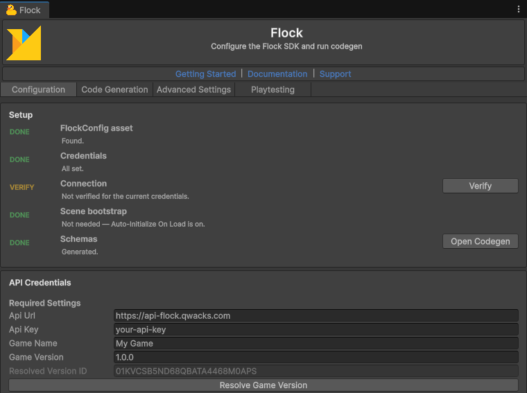

# Flock Unity SDK

The Flock Unity SDK provides access to Flock's game backend services from Unity games.

## Contents

- [Features](#features)
- [Requirements](#requirements)
- [Installation](#installation)
- [Setup](#setup)
  - [Editor Configuration](#editor-configuration)
  - [Automatic Initialization](#automatic-initialization-default)
  - [Drop-in Initialization](#drop-in-initialization)
  - [Code-Based Configuration](#code-based-configuration)
  - [Push notifications: dashboard setup](#push-notifications-dashboard-setup)
- [Quick Start](#quick-start)
- [Feature guides](#feature-guides)
- [Multiplayer](#multiplayer)
- [Playtesting with Protokite](#playtesting-with-protokite)
- [Error handling](#error-handling)
- [Offline caching](#offline-caching)
- [Platform notes](#platform-notes)

## Features

- Player authentication (email, device, Google, Apple, Steam, Facebook, Discord)
- Account linking — attach or detach extra credentials on a signed-in player, so a guest account can be claimed and reached any of those ways
- Account flows: password reset, email verification, display-name availability check
- Token refresh with automatic silent retry, plus a session-expired event
- Server-side token revocation (kill a stolen refresh token — most game backends don't expose this to the client)
- Game configuration — typed accessors generated from your schemas (via codegen), with the values resolved for the signed-in player (patches, segment and player overrides)
- Game and game version metadata
- Player data — read with pagination; typed player-data and template accessors via codegen
- Shop (browse shops, items, one purchase call for every item: from the wallet, or for real money through FlockStore, the App Store or Google Play with Unity IAP 5 on a phone and a web checkout (Stripe, Tap or Moyasar) on other platforms; inventory and using items, the player's wallet, restore, redeem store purchases from your own store code, a shop sample)
- Leaderboards — standings, the player's own rank, and an around-me slice, by board name
- Game commands (server-side operations: update player data, add funds)
- Player ban lookup
- Notification inbox (list, unread count, mark read), server-side scheduling of dashboard-authored templates, and push device-token registration
- Asset listing and lookup by ID or name
- Multiplayer — parties, matchmaking and sessions, with players connected over Netcode for GameObjects 1.x or 2.x, directly or through Flock's relay, and a new host taking over when the host leaves
- Analytics (gameplay events, session tracking, transactions, diagnostics — no-op safe when disabled)
- Automatic retry with exponential backoff
- Offline-safe init (no network at startup) — plus disk-cached static content that keeps serving without network after one online session
- Sign-in token management
- Strongly typed codegen for player templates, game configs, shops and achievements (the **Code Generation** tab in **Flock > Settings**)
- Hands-off startup — the SDK initializes itself from your config at launch (or use the drop-in `FlockBootstrap` component, or call `Create` yourself)

## Requirements

- **Unity 2021.3 or newer.**
- **Newtonsoft Json for Unity** (`com.unity.nuget.newtonsoft-json`, 3.0.2 or newer) — the SDK uses it to read and write JSON.
  An install from a Git URL adds it for you; before importing the `.unitypackage`, add it yourself: **Window > Package
  Manager**, **+**, **Add package by name**, `com.unity.nuget.newtonsoft-json`.
- **Netcode for GameObjects 1.x or 2.x** (`com.unity.netcode.gameobjects`) — only to connect players in multiplayer. The SDK's netcode support compiles only when it is installed; parties, matchmaking and sessions work without it.

## Installation

Add the SDK to your Unity project in one of two ways.

**From a `.unitypackage`.** Download `FlockSDK-<version>.unitypackage` from the latest release at
[github.com/QwackStack/FlockUnitySdk/releases](https://github.com/QwackStack/FlockUnitySdk/releases), then double-click it
(or use **Assets > Import Package > Custom Package**) and import every item. Add Newtonsoft Json first (see
[Requirements](#requirements)).

**From a Git URL.** Open **Window > Package Manager**, click **+**, choose **Add package from git URL**, and enter:

```
https://github.com/QwackStack/FlockUnitySDK.git#v1.102.0
```

The part after `#` is the release tag; change it to the version you want. Git must be installed on your computer for this
way. The Package Manager adds Newtonsoft Json for you, and updating the SDK is a matter of changing the tag.

## Setup

### Editor Configuration

Open **Flock > Settings** in the Unity menu bar. On the **Configuration** tab, the **Setup** card lists what is still
missing; click **Create** on its **FlockConfig asset** row if your project has no `FlockConfig` asset yet. Then fill in the
**API Credentials** card:

- **Api Url** — the Flock API address (default: `https://api-flock.qwacks.com`)
- **Api Key** — your game's API key, from the Flock dashboard
- **Game Name** — your game's name, as it reads in the Flock dashboard
- **Game Version** — the name of the Game Version this build plays (for example `1.0.0`)

When the four are set, the window resolves the Game Version by itself and shows its ID under **Resolved Version ID**; click
**Resolve Game Version** to do it again. The ID is saved into the asset, so starting the SDK makes no network call.


*Flock > Settings, Configuration tab: the Setup card at the top, the API Credentials card below it with Api Url, Api Key, Game Name and Game Version filled in, and the Resolved Version ID shown after Resolve Game Version.*

The window edits `Assets/Resources/FlockConfig.asset` directly, so there is no Save button; the SDK loads that asset in a
build. The **Code Generation** tab runs **Sync Schemas** (see the [Codegen guide](Docs~/codegen.md)), and the
**Advanced Settings** tab holds analytics, caching, retry and multiplayer settings.

### Automatic Initialization (default)

The SDK starts itself — no component, no init code. **Auto-Initialize On Load** is on by default (**Advanced Settings** tab,
**Tools** card), so the SDK initializes from `FlockConfig` before the first scene loads and restores the player's saved
sign-in in the background. Use `FlockClient.Instance` whenever you need it.

To react when the saved sign-in has been checked, subscribe to `FlockEvents.OnSessionRestored`. The restore may finish
before your script subscribes, and only `OnInitialized` and `OnInitializationFailed` are replayed to late subscribers, so
check `FlockClient.IsRestoringSession` too:

```csharp
using Flock;
using UnityEngine;

public class StartScreen : MonoBehaviour
{
    private void OnEnable()
    {
        FlockEvents.OnSessionRestored += HandleSessionRestored;

        // The restore may already be over: then read its result now.
        if (FlockClient.IsInitialized && !FlockClient.IsRestoringSession)
            HandleSessionRestored(FlockClient.Instance.IsAuthenticated);
    }

    private void OnDisable()
    {
        FlockEvents.OnSessionRestored -= HandleSessionRestored;
    }

    private void HandleSessionRestored(bool signedIn)
    {
        Debug.Log(signedIn ? "Welcome back" : "Show the login screen");
    }
}
```

To start the SDK yourself — for example after a splash screen or once the player accepts your terms — turn
**Auto-Initialize On Load** off and use one of the two ways below.

> **Init is fail-fast.** A bad config makes `Create` throw (the automatic start catches and logs it instead of crashing
> the game). Either way the SDK stays uninitialized and `FlockClient.Instance` throws until a successful init — so check
> `FlockClient.IsInitialized`, read `FlockClient.InitializationError`, or handle `FlockEvents.OnInitializationFailed`.

### Drop-in Initialization

With **Auto-Initialize On Load** off, a `FlockBootstrap` component can start the SDK from a scene. On the **Configuration**
tab's **Setup** card, click **Add to Scene** on the **Scene bootstrap** row (or add a `FlockBootstrap` component to a GameObject
yourself). It holds a reference to your `FlockConfig` asset and starts the SDK in `Awake`; with **Initialize On Awake**
off, it waits for your call:

```csharp
using System;
using Flock;
using UnityEngine;

public class SplashScreen : MonoBehaviour
{
    [SerializeField] private FlockBootstrap bootstrap;   // drag the scene's FlockBootstrap here

    private void OnEnable()
    {
        bootstrap.OnInitialized += HandleInitialized;
        bootstrap.OnInitializationFailed += HandleInitializationFailed;
    }

    private void OnDisable()
    {
        bootstrap.OnInitialized -= HandleInitialized;
        bootstrap.OnInitializationFailed -= HandleInitializationFailed;
    }

    // Call this once the splash screen is done (with Initialize On Awake off).
    public void StartFlock()
    {
        bootstrap.Initialize();
    }

    private void HandleInitialized()
    {
        Debug.Log("Flock SDK ready");
    }

    private void HandleInitializationFailed(Exception error)
    {
        Debug.LogException(error);
    }
}
```

The component never copies values from the asset; it always reads through the reference, so editing the asset is enough
to change what it does. Place it in a boot scene loaded once at startup, and leave **Dont Destroy On Load** on.

### Code-Based Configuration

For full control, turn **Auto-Initialize On Load** off and create the client yourself, **once**, at startup. After `Create`
returns, call everything through `FlockClient.Instance` from anywhere; reading `FlockClient.Instance` before then throws a
`FlockException`.

```csharp
using Flock;
using Flock.Config;
using UnityEngine;

public class FlockStartup : MonoBehaviour
{
    private async void Awake()
    {
        FlockConfigAsset configAsset = Resources.Load<FlockConfigAsset>("FlockConfig");

        // Synchronous, with no network call: the Game Version ID was saved into the asset by Flock > Settings.
        FlockClient.Create(configAsset.ToInitConfig());

        // Create alone does not bring back the saved sign-in; this does (and raises FlockEvents.OnSessionRestored).
        bool signedIn = await FlockClient.Instance.Authentication.TryRestoreSessionAsync();
        Debug.Log(signedIn ? "Welcome back" : "Show the login screen");
    }
}
```

`ToInitConfig()` returns a `FlockInitConfig`; change its properties (for example `EnableAssetCache`) before passing it to
`Create` to set what the editor window does not show.

### Push notifications: dashboard setup

The notification **inbox** and **scheduling** need nothing beyond the settings above. **Push delivery** additionally needs provider credentials on the dashboard, under **Settings > Push Notifications**. Credentials are per game, stored encrypted, and write-only — replaceable, never readable back.

| Provider | Delivers to | What to supply |
| --- | --- | --- |
| Firebase Cloud Messaging (FCM) | Android and web | The full contents of the Firebase service-account JSON file |
| Apple Push Notification service (APNs) | iOS | The `.p8` signing key, its **Key ID**, your **Team ID**, the app's **Bundle ID**, and **Use APNs sandbox** for development builds |

Until a provider reads **Configured**, device tokens register successfully and nothing is ever delivered on that platform. That is the usual cause of "push is broken" — the client reports success because registration genuinely succeeded.

Scheduling also needs a **template** to schedule: author one under **Marketing > Templates** with its title, body, locale, channels, and any `{placeholders}` you fill at send time. `ScheduleAsync` takes the template's **name**. See the [Notifications guide](Docs~/notifications.md).

## Quick Start

The shortest path from zero to reading data: wait for the saved sign-in to be checked, sign the player in with this
device (registering it the first time), then read something back. Add this component to a GameObject in your first scene
and press Play.

```csharp
using System.Threading.Tasks;
using Flock;
using Flock.Exceptions;
using Flock.Models;
using UnityEngine;

public class FlockQuickStart : MonoBehaviour
{
    private async void Start()
    {
        try
        {
            // The SDK started itself before this scene; wait while it brings back the saved sign-in.
            while (FlockClient.IsRestoringSession)
                await Task.Yield();

            if (!FlockClient.Instance.IsAuthenticated)
                await SignInWithThisDeviceAsync();

            GameSchema game = await FlockClient.Instance.Game.GetGameAsync();
            Debug.Log($"Signed in as {FlockClient.Instance.CurrentPlayerId}, playing {game.Name}");
        }
        catch (FlockException ex)
        {
            // The message says what went wrong and, on its Fix: line, what to do.
            Debug.LogError(ex.Message);
        }
    }

    // With no id, both calls use the device id the SDK keeps for this install, so the same player comes back every launch.
    private static async Task SignInWithThisDeviceAsync()
    {
        try
        {
            await FlockClient.Instance.Authentication.LoginWithDeviceAsync();
        }
        catch (FlockException ex) when (ex.ErrorCode == FlockErrorCode.PlayerInvalidLoginCredentials)
        {
            // First launch on this device: make the account, which also signs the player in.
            await FlockClient.Instance.Authentication.RegisterWithDeviceAsync();
        }
    }
}
```

The device id is `Authentication.ThisDeviceId`: the SDK makes it the first time it is needed and keeps it in the game's
saved files. A new one comes after a reinstall, clearing the app's data or deleting the file, and on WebGL after clearing
the site's data, in a private window, or when the game is served from another page address; restoring a phone from a
backup can bring the old one back. If your game already signs players in with an id of its own (such as
`SystemInfo.deviceUniqueIdentifier`), keep passing that id, or those players get a new account; see
[Which device id](Docs~/authentication.md#signing-a-player-in). Auth calls throw on failure, so the `catch` sees every
problem. The `Samples/QuickStart` folder has the same steps behind buttons.

## Feature guides

Per-feature usage and examples live in their own guides:

| Guide | Covers |
|-------|--------|
| [Authentication](Docs~/authentication.md) | Login/register for every provider, account linking/unlinking, logout, token refresh/revocation, password reset, email verification, session expiry |
| [Game & Config](Docs~/game-config.md) | Typed game-config accessors, values for the signed-in player, game/version metadata |
| [Player Data & Game Commands](Docs~/player-data.md) | Reads, typed template accessors, update commands, funds, achievements, bans |
| [Shop](Docs~/shop.md) | Shops, items, purchase (money-safety contract), a shop screen (wallet, owned items, what the player can afford), real-money items, store purchases, buying with real money (Unity IAP 5 on a phone, a web checkout elsewhere), player inventory |
| [Leaderboards](Docs~/leaderboards.md) | Standings, my-rank, around-me by board name; windows, board config, score formatting |
| [Assets](Docs~/assets.md) | Listing/lookup, typed downloads, disk cache, preloading |
| [Notifications](Docs~/notifications.md) | Player inbox, unread badge event, scheduling a template for later, pending-schedule tracking, push device tokens |
| [Multiplayer](Docs~/multiplayer.md) | Parties, matchmaking, sessions, connecting players over Netcode for GameObjects, Flock's relay and direct paths, host changes, other networking |
| [Analytics](Docs~/analytics.md) | Gameplay events, sessions, transactions, diagnostics, exception capture, consent, unexpected-termination detection |
| [SDK Events](Docs~/events.md) | The `FlockEvents` hub — lifecycle, auth, and session events |
| [Codegen](Docs~/codegen.md) | Sync Schemas, generated templates/configs/shops/achievements, content catalog |
| [Error handling](Docs~/errors.md) | The `FlockException` hierarchy, `.ErrorCode`, and the full coded-error list |
| [HTTP and your own providers](Docs~/http.md) | Your game's identity for another Qwacks service, requests with or without an answer to read, retrying the way the SDK does, streamed file uploads, a provider of your own |

## Multiplayer

Friends form a party, find a match together (or join a friend's game by its code), and play in a session that one of
them hosts. The SDK keeps each seat, follows the party, the search and the session in the background, and connects the
players over Netcode for GameObjects: directly on the host's network, through Flock's relay from anywhere else. When
the host leaves, another player takes over.

```csharp
using System.Threading.Tasks;
using Flock;
using Flock.Providers;
using Unity.Netcode;
using UnityEngine;

public class PlayWithAFriend : MonoBehaviour
{
    // One player hosts and reads out the code.
    public async Task HostAsync()
    {
        FlockMultiplayerSession session = await FlockClient.Instance.Multiplayer.HostSessionAsync();
        Debug.Log($"Join code: {session.JoinCode}");
        FlockNetcodeStartResult started = await session.StartNetcodeAsync(NetworkManager.Singleton);
        Debug.Log($"Netcode: {started.Outcome}");
    }

    // A friend joins with the code the host read out.
    public async Task JoinAsync(string typedCode)
    {
        FlockMultiplayerSession session = await FlockClient.Instance.Multiplayer.JoinSessionAsync(typedCode);
        FlockNetcodeStartResult started = await session.StartNetcodeAsync(NetworkManager.Singleton);
        Debug.Log($"Netcode: {started.Outcome}");
    }
}
```

Install Netcode for GameObjects 1.x or 2.x, sign the player in first, check the dashboard's multiplayer settings, and make
a queue for each mode your game matches players in. The [Multiplayer guide](Docs~/multiplayer.md) covers parties,
matchmaking, every outcome, the relay and host changes; the `Samples/Multiplayer` folder has a Play With Friends and a
Quick Match sample.

## Playtesting with Protokite

The **Protokite Playtest** package records play sessions, gameplay and in-game feedback for your Protokite playtests. It
is a separate package, released with each Flock SDK version; the SDK itself never depends on it.

To add it, open **Flock > Settings**, go to the **Playtesting** tab and press **Install Protokite Playtest**. It downloads
the version that matches your Flock SDK and imports it, with no Git needed. The same tab opens its settings, updates it
when you update Flock, and removes it. The [step-by-step guide](https://docs.qwacks.com/protokite/unity-package) takes you
from installing it to a first playtest session, with screenshots; every setting and call is in
[its README](ProtokitePlaytest~/README.md).

## Error handling

Every SDK call throws on failure — there are no result/error return types. Server errors surface as a `FlockException`
(or a subtype: `FlockAuthException`, `FlockValidationException`, `FlockNetworkException`, `FlockSerializationException`,
and `FlockStoreException` for a store that did not take a payment) carrying a typed `ErrorCode` you can branch on:

```csharp
using System.Threading.Tasks;
using Flock;
using Flock.Exceptions;
using UnityEngine;

public static class BuyButton
{
    // shopItemId is a shop item's Id (ShopItem.Id), read from a shop.
    public static async Task BuyAsync(string shopItemId)
    {
        try
        {
            await FlockClient.Instance.Shop.PurchaseAsync(shopItemId);
        }
        catch (FlockException ex) when (ex.ErrorCode == FlockErrorCode.ShopInsufficientFunds)
        {
            Debug.Log("Not enough currency: nothing was bought.");
        }
        catch (FlockException ex)
        {
            Debug.LogError(ex.Message);
        }
    }
}
```

`ex.Message` names the call that failed, the server's own reason, the coded identifier and the status — then a `Fix:` line with the next step:

```
Device login failed: Invalid login credentials [player.invalid_login_credentials, HTTP 400]
Fix: This device is not registered yet. Call Authentication.RegisterWithDeviceAsync() once to create the account, then Authentication.LoginWithDeviceAsync() on later launches (both use Authentication.ThisDeviceId when no id is passed).
```

Branch on `ErrorCode`, never on message text — codes are stable, wording is not. `FlockException`, `FlockErrorCode` and
the other types are in the `Flock.Exceptions` namespace; `FlockStoreException` is in `Flock.Providers`.

See the [Error handling guide](Docs~/errors.md) for the exception types, the status→exception mapping, and the full `FlockErrorCode` list.

## Offline caching

Reads are saved to disk and served when the server is unreachable, after at least one online session — the server is
always tried first, with no expiry times. Switch it with **Enable Offline Cache** (**Flock > Settings**, **Advanced
Settings** tab, **Offline Cache** card; on by default, and on every platform until you untick it: untick it for a WebGL
build — see [Platform notes](#platform-notes)); **Offline
Cache Directory** sets where it is kept (empty means `Application.persistentDataPath/Flock/snapshots`). Each service has
`ClearCache()`; bans, inventory, and purchases are never cached. See [ARCHITECTURE.md](ARCHITECTURE.md) for what
refreshes when.

## Platform notes

- **WebGL**: SDK HTTP automatically switches to `UnityWebRequest` on WebGL builds
  (`System.Net.Http.HttpClient` has no WebGL transport), so auth, read APIs, and
  analytics work online with no caller changes. The asset cache and the offline
  cache, however, are kept under `Application.persistentDataPath`, which on
  WebGL is stored in the browser and does not support synchronous file writes
  (`File.WriteAllBytes` will fail). For a WebGL build, untick **Enable Asset Cache** and **Enable Offline Cache** in
  **Flock > Settings**, **Advanced Settings** tab. A game that starts the SDK itself (see
  [Code-Based Configuration](#code-based-configuration)) can instead set `EnableAssetCache = false` and
  `EnableOfflineCache = false` on the `FlockInitConfig` before `Create`. Everything else works online, just without the
  disk caches.
  The SDK's own saved files (queued analytics, session records, the device id) are copied to the browser's storage after each change, so
  they survive a reload; two tabs of one game share that storage, and the last to save wins (so two tabs opened on a fresh
  install can each make a device id, and the one saved last is kept). A game that sets
  `autoSyncPersistentDataPath` in its WebGL template keeps Unity's own copying.
